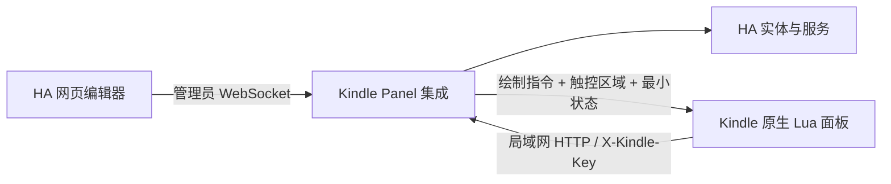

# 架构

## 布局模型

布局为 `页面 → 分组 → 卡片`（`protocol.py`）：

- 页面：名称、列数（1–4），最多 8 页。
- 分组：名称（可空，空则不显示标题栏）、行数、是否显示小结；一页所有分组合计最多 8 行。
- 卡片：实体、名称、图标、宽 `w` × 高 `h`（格）及位置 `x/y`。服务端保留不冲突的显式位置，其余按行优先放入第一个空位；放不下时返回明确错误。

0.2 的平铺布局（`columns/rows/tiles/span`）在读取时自动迁移，按原分页拆成多个页面。

## 服务端渲染

`render.py` 把每一页渲染成**绘制指令**（矩形 / 文字 / 图标，物理像素）与**触控区域**。Kindle 插件与网页预览都只负责按指令绘制，因此预览与实机画面一致，版式逻辑全部在 Python 中测试。

- 卡片按实际像素大小选择版式：大卡片、紧凑卡片、横条卡片；空调另有完整（含模式条）、紧凑（单行 −/+）和极小三种。
- 文字指令可带半字号单位、对齐方式和最大宽度；`k` 字段标记由设备填写的内容（状态行、电量、Wi-Fi、背光按钮）。
- 图标颜色为 `k`/`w`/`g`，对应构建生成的黑、白、浅灰三套 SVG。
- 触控区域要么指向已保存卡片和允许的动作（`power`、`activate`、`temperature`、`mode`），要么是本地动作（刷新、菜单、背光、翻页）。

`display.py` 把原始状态转换成中文短文案：二元传感器按设备类别显示「已打开 / 无人 / 已上锁」等，门锁、窗帘、媒体、扫地机等常见域均有翻译；数值遵循实体注册表的显示精度。

温度单位：布局可设 `auto`（跟随 HA）、`°C` 或 `°F`。空调属性始终以 HA 系统单位提供，服务端换算后显示；单位不同时显示步长为 0.5 °C 或 1 °F，设备请求的目标温度换算回系统单位并对齐 HA 的步长网格。

## 配对与权限

管理员 WebSocket `kindle_panel/manage` 支持 load、preview、save、pair、revoke。保存使用布局修订号，避免覆盖并发修改。预览不执行服务。撤销配对会同时删除 HA 设备注册表中的对应设备。

配对码为随机一次性代码，有效期十分钟。设备 POST `/api/kindle_panel/pair` 后获得独立密钥；HA 仅持久化哈希，设备将密钥保存在 `/var/local/nativeha/device-key`（目录 0700、文件 0600），并移除导入文件。配对文件中的服务器地址由编辑器填写，只接受局域网 `http://` 地址；HA 配置了内网地址时会自动建议。

后续设备请求使用 `X-Kindle-Key`：

| 接口 | 行为 |
| --- | --- |
| `POST /api/kindle_panel/device/snapshot` | 更新电量、充电与在线信息，返回全部页面的绘制指令和最小状态（可用性与原始状态值） |
| `POST /api/kindle_panel/device/action` | 校验设备、配对用户权限、布局修订号、卡片及服务白名单 |

客户端不能指定任意实体和服务。开关类使用显式开/关；空调温度校验实时范围、步长和开关状态，模式必须在实体支持列表中；场景、脚本、按钮使用各自允许的服务。其他实体只读。移除集成会删除持久设备密钥哈希。

## 原生端

`deviceapi.lua` 校验画面：协议版本、屏幕尺寸、页数、每条指令的坐标范围、图标名（只允许小写字母和连字符）、触控区域只能指向有状态的卡片。过期超过一分钟或离线的状态不能直接控制。

`panelwidget.lua` 按指令绘制，处理点击、滑动翻页和长按菜单，绘制按下反馈与背光面板；每 12 次局部刷新做一次全屏刷新以消除墨水屏残影，翻页时闪刷。

控制器管理刷新、配对、缓存、休眠和充电事件。点击过期状态的卡片时，先刷新，再在新画面上重新定位同一位置的动作并执行，因此一次点击即可完成，且动作（如开关方向、下一档温度）总是基于最新状态。背光通过 KOReader 的 powerd 接口调节。外接电时使用 KOReader 的 keepalive 与 Kindle powerd 接口；电池时释放常驻，屏保设置保留当前画面，退出恢复设置。每次启动只保存一张诊断截图。

开机任务在 `framework_ready` 后运行，只在用户分区已挂载可读写、已配对且未禁用时启动。启动器使用进程锁，退出恢复电源属性。手动退出标记保存在 /tmp，重启后自然清除。
