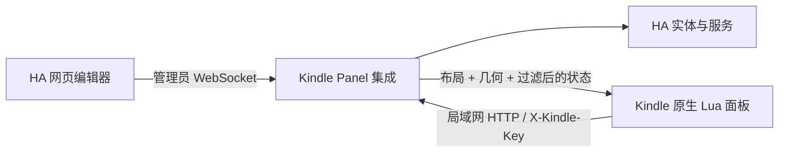

# 架构

编辑器为原生 Web Component，使用 HA 提供的 `hass` 接口。后端规范化布局、计算卡片位置和字体指标；浏览器与 Kindle 消费同一份几何。构建脚本将同一套 SVG 图标输出到两端。

## 配对与权限

管理员 WebSocket `kindle_panel/manage` 支持 load、preview、save、pair、revoke。保存使用布局修订号，避免覆盖并发修改。预览不执行服务。

配对码为随机一次性代码，有效期十分钟。设备 POST `/api/kindle_panel/pair` 后获得独立密钥；HA 仅持久化哈希，设备将密钥保存在 `/var/local/nativeha/device-key`（目录 0700、文件 0600），并移除导入文件。

后续设备请求使用 `X-Kindle-Key`：

| 接口 | 行为 |
| --- | --- |
| `POST /api/kindle_panel/device/snapshot` | 更新电池与在线信息，返回已选卡片的布局、几何和过滤状态 |
| `POST /api/kindle_panel/device/action` | 校验设备、配对用户权限、布局修订号、卡片及服务白名单 |

客户端不能指定任意实体和服务。开关、灯、风扇使用显式开/关；空调温度校验实时范围、步长和开关状态；场景、脚本、按钮使用各自允许的服务。其他实体仅读取过滤后的状态。移除集成会删除持久设备密钥哈希。

## 原生端

`deviceapi.lua` 校验快照，过期超过一分钟或离线的状态不能直接控制。传输层限制 API 路径、响应大小和网络超时，不跟随重定向、不自动重试写操作、不将低层凭据错误展示给用户。

`panelwidget.lua` 用 KOReader 控件绘制并处理触摸。字号抵消 KOReader 的二次 UI 缩放，维护弹窗置于卡片界面之上。

控制器管理刷新、配对、缓存、休眠和充电事件。外接电时使用 KOReader 的 keepalive 与 Kindle powerd 接口；电池时释放常驻，屏保设置保留当前画面，退出恢复设置。每次启动只保存一张诊断截图，不持续写截图。

开机任务在 `framework_ready` 后运行，只在用户分区已挂载可读写、已配对且未禁用时启动。启动器使用进程锁，退出恢复电源属性。手动退出标记保存在 /tmp，重启后自然清除。
